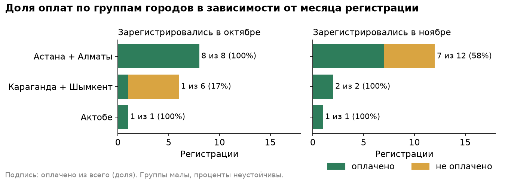
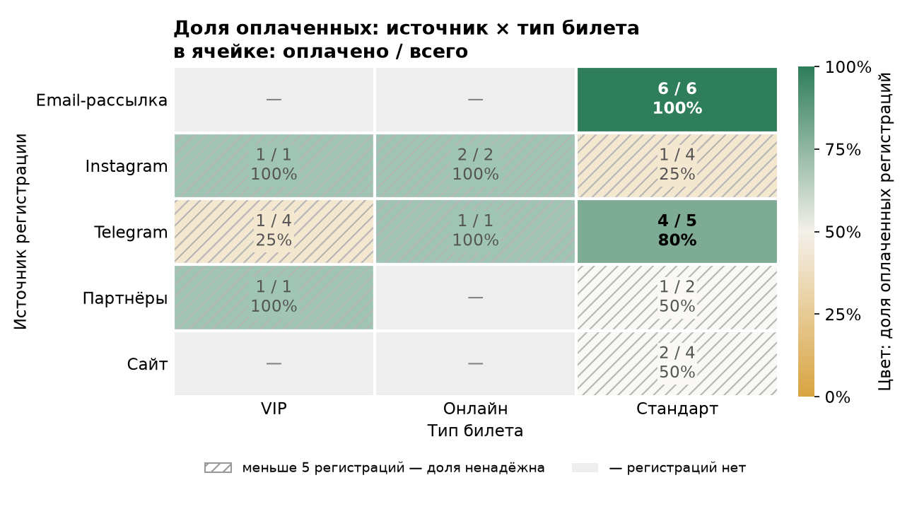

# registration-analysis

Учебный проект: анализ регистраций на мероприятие с помощью Claude Code, а затем критический аудит этого анализа и исправление найденных проблем.

---

## 1. О проекте

Цель проекта — по файлу `registrations.csv` понять, как устроены регистрации на мероприятие: сколько людей зарегистрировалось и оплатило, из каких городов и источников они пришли, какие билеты выбирали и что из этого полезно знать организаторам.

Работа шла в три этапа:

1. **Анализ по структурированному промпту.** Claude Code получил промпт из разделов «Задача / Контекст / Формат / Готово, когда» и сначала задал 3 уточняющих вопроса. После ответов он написал скрипт `analysis.py`, отчёт `report.md` и графики в `charts/` (commit `8bc2d8e`).
2. **Критический аудит.** В отдельной сессии Claude Code проверил результат, ничего не меняя в файлах: пересчитал цифры, проверил выводы, графики и рекомендации.
3. **Исправления.** По итогам аудита исправлены две проблемы, B1 и E1 (commit `b5df389`). Остальные замечания аудита пока **не исправлены**, они перечислены в разделе 5.

Исходный `registrations.csv` за всё время не изменялся.

---

## 2. Исходные данные

`registrations.csv` — 30 регистраций с 20 октября по 13 ноября 2026 года, кодировка UTF-8, разделитель запятая.

| Поле | Что означает | Значения в данных |
|---|---|---|
| `name` | имя участника (без фамилии) | 30 разных имён |
| `city` | город | Астана, Алматы, Караганда, Шымкент, Актобе |
| `registered` | дата регистрации, `ГГГГ-ММ-ДД` | с 2026-10-20 по 2026-11-13 |
| `source` | источник регистрации | Telegram, Instagram, Email-рассылка, Сайт, Партнёры |
| `ticket` | тип билета | Стандарт, VIP, Онлайн |
| `paid` | статус оплаты | «да» / «нет» |

Пустых значений, лишних пробелов, разного написания и дубликатов в файле нет. Чего в данных **нет**: email или телефона, цен билетов, даты оплаты, даты мероприятия и даты выгрузки файла. Это ограничивает выводы (подробнее в разделе 9 отчёта и в замечании D1 аудита).

---

## 3. Первоначальный промпт

Ниже полный текст промпта, с которого начался анализ (без сокращений):

```text
Я хочу проанализировать данные регистраций мероприятия и получить понятный аналитический отчёт.

ЗАДАЧА

Проанализируй файл registrations.csv, который находится в текущей папке.

Нужно изучить регистрации и найти основные закономерности в данных:
- сколько всего регистраций;
- сколько оплаченных и неоплаченных регистраций;
- какие города дают больше всего регистраций;
- какие источники регистрации работают лучше;
- какие типы билетов наиболее популярны;
- есть ли различия между источниками, городами и типами билетов;
- какие данные или закономерности могут быть полезны организаторам мероприятия.

КОНТЕКСТ

Это данные о регистрациях на мероприятие.

В CSV есть следующие поля:
- name — имя участника;
- city — город;
- registered — дата регистрации;
- source — источник регистрации;
- ticket — тип билета;
- paid — статус оплаты.

Не изменяй исходный registrations.csv.

Работай только с данными, которые действительно есть в файле. Не придумывай отсутствующие значения и не делай выводы, которые нельзя подтвердить данными.

ФОРМАТ

Создай понятный аналитический отчёт.

Структура результата:

1. Краткое резюме
2. Общая статистика
3. Анализ городов
4. Анализ источников регистрации
5. Анализ типов билетов
6. Анализ оплат
7. Взаимосвязи между показателями
8. Найденные интересные закономерности
9. Возможные проблемы качества данных
10. Практические выводы для организаторов

Для важных показателей используй таблицы.

Если возможно, добавь простые визуализации или графики, которые помогают понять данные.

ГОТОВО, КОГДА

Работа считается готовой, когда:
- весь registrations.csv проанализирован;
- основные показатели рассчитаны;
- выводы подтверждаются данными;
- потенциальные проблемы в данных отдельно отмечены;
- результат понятен человеку без глубоких знаний в анализе данных;
- исходный CSV не изменён.

ВАЖНО

Сначала задай мне ровно 3 уточняющих вопроса, которые помогут тебе лучше выполнить анализ.

Не начинай анализ до того, как я отвечу на эти 3 вопроса.
```

### Структура промпта

| Блок | Зачем нужен |
|---|---|
| **Задача** | что именно проанализировать и на какие вопросы ответить |
| **Контекст** | что за данные, какие в них поля и какие есть ограничения (не менять CSV, не выдумывать) |
| **Формат** | точная структура отчёта из 10 разделов, таблицы и графики |
| **Готово, когда** | проверяемые критерии готовности результата |
| **Сначала задай мне 3 вопроса** | блок «ВАЖНО»: модель не начинает работу, пока не уточнит детали |

### 3 уточняющих вопроса и ответы

| Вопрос Claude Code | Выбранный ответ |
|---|---|
| В каком виде сделать отчёт? | Markdown + PNG |
| По какому признаку считать, что источник регистрации «работает лучше»? | Оба показателя: и число регистраций, и доля оплаченных |
| Если в данных найдутся проблемы (дубликаты, разное написание городов, пустые значения), как с ними поступить? | Нормализовать и отметить в отчёте |

---

## 4. Первоначальный результат

Commit `8bc2d8e` — «Add registration analysis report with charts».

| Файл | Что делает |
|---|---|
| [`analysis.py`](analysis.py) | читает CSV (только чтение), проверяет качество данных, нормализует значения, считает все показатели и сохраняет графики |
| [`report.md`](report.md) | отчёт из 10 разделов по структуре из промпта |
| [`charts/`](charts) | графики: статус оплаты, города, источники, билеты, динамика по дням, источник × тип билета |

**Что было посчитано и найдено (реальные цифры):**

- **Всего 30 регистраций, оплачено 20 (67%)**, не оплачено 10 (33%).
- **Города:** Астана 12 (оплачено 9), Алматы 8 (6), Караганда 5 (2), Шымкент 3 (1), Актобе 2 (2). В целом Астана + Алматы оплатили 75%, Караганда + Шымкент 38%.
- **Источники:** Telegram 10 (оплачено 6), Instagram 7 (4), Email-рассылка 6 (6 из 6), Сайт 4 (2), Партнёры 3 (2). Email и Telegram дали одинаково по 6 оплат, но Telegram понадобилось для этого 10 регистраций.
- **Билеты:** Стандарт 21 (оплачено 14), VIP 6 (3), Онлайн 3 (3). VIP из Telegram оплачен только 1 из 4.
- **Динамика:** пик в неделю 2–8 ноября (13 регистраций), самый активный день 7 ноября (5 регистраций, все оплачены). До и после 1 ноября по 15 регистраций, в обеих половинах оплачено 67%.
- **Неоплаченные:** полный список из 10 человек. 5 «давних» (21–30 октября, все из Караганды и Шымкента) и 5 «свежих» (4–13 ноября, все из Астаны и Алматы).
- **Перекрёстные таблицы:** источник × билет, город × источник, город × билет.
- **Качество данных:** проверены пустые значения, пробелы, регистр, дубликаты, формат дат и значения `paid`, перечислены ограничения (мало строк, нет ID, цен, даты оплаты).
- **7 практических рекомендаций** для организаторов.

---

## 5. Критический аудит

Аудит проводился в новой сессии Claude Code с явным запретом менять файлы. Все цифры отчёта были пересчитаны по CSV вручную, для ключевых различий посчитаны точный тест Фишера и 95% доверительные интервалы. Итог: почти все расчёты верны, но нашлась одна фактическая ошибка, пропущенная закономерность и ряд слишком уверенных выводов.

### A. Ошибки расчётов и фактов

- **A1. Неверное утверждение «Во всех группах меньше 13 человек».** В группе «Стандарт» 21 регистрация, в неделе 2–8 ноября ровно 13. Отчёт противоречит собственным таблицам. *Не исправлено.*
- **A2.** В резюме «75%» означает долю от всех оплат, а в разделе 3 то же число означает долю оплативших. Два разных показателя выглядят как один.
- **A3.** Возраст неоплат («2+ недели») считается от последней регистрации (13.11), а не от даты выгрузки, которая неизвестна.
- **A4.** В таблице проверок качества пример «москва/Москва», хотя Москвы в данных нет.

### B. Пропущенные закономерности

- **B1. Разрыв между городами есть только у октябрьских регистраций.** Общие «75% против 38%» складываются из двух противоположных картин: в октябре Астана + Алматы 8/8, Караганда + Шымкент 1/6, в ноябре 7/12 против 2/2. Город и время регистрации перепутаны. *Исправлено (раздел 6).*
- **B2.** Вывод «время регистрации не связано с оплатой» опирался на совпадение двух противоположных трендов (одинаковые 67%). *Частично затронуто исправлением B1: пункт 5 раздела 8 отчёта уточнён.*

### C. Недостаточно обоснованные выводы

- **C1. Ни одно различие не проверено на статистическую значимость, но в резюме они поданы как факты.** Например: Астана + Алматы против Караганды + Шымкента p ≈ 0,09; Email против остальных p ≈ 0,07; VIP из Telegram против остальных VIP p ≈ 0,40; соцсети против остальных p ≈ 0,44. Доверительный интервал для Email (6 из 6) — 54–100%, для Telegram (6 из 10) — 26–88%. *Не исправлено.*
- **C2.** «Email — это люди, знакомые с организаторами» — предположение, которого нет в данных. Кроме того, Email приводил людей только из Астаны, Алматы и Актобе.
- **C3.** «Главная зона риска — VIP из Telegram» основана на 4 наблюдениях, две из трёх неоплат свежие (08.11 и 13.11).
- **C4.** Рекомендации о том, кому звонить первым, противоречат друг другу (давние или VIP).
- **C5.** «Проверить путь до оплаты в Telegram/Instagram» — при p ≈ 0,44, хотя хуже всех платит Сайт (50%).
- **C6.** «Поток остановился после 8 ноября» — возможно, данные просто обрезаны датой выгрузки.

### D. Проблемы качества и структуры данных

- **D1. Нет даты выгрузки, даты мероприятия и даты оплаты.** Без них выводы о «давних» и «зависших» неоплатах по сути не проверить. *Это ограничение самих данных, в рамках проекта не исправить.*
- **D2.** Неясно, проходит мероприятие в одном городе или в нескольких.
- **D3.** Неизвестно, как присваивается источник (сам человек, UTM-метка, последнее касание).
- **D4.** Поле `paid` бинарное: не различаются возвраты, бесплатные пропуска, отмены.
- **D5.** Плохая воспроизводимость: в Windows консоль выводит текст кракозябрами, нет `requirements.txt`, таблицы в отчёт перенесены вручную.

### E. Недостатки визуализаций

- **E1. Тепловая карта «Источник × тип билета»: цвет показывал число регистраций, а подписи — оплату.** Ячейка «1 из 4» (VIP из Telegram) была тёмной и выглядела как успех. *Исправлено (раздел 6).*
- **E2.** Накопительный график: линия «оплаченные» построена по дате регистрации, а не оплаты.
- **E3.** `paid_status.png` почти не несёт информации (одна полоса с двумя числами).
- **E4.** Проценты на столбчатых графиках без интервалов неопределённости.
- **E5.** Нет графиков для практических вопросов: возраст неоплат, город по месяцам (последнее исправлено вместе с B1).

### F. Недостающие практические выводы

- **F1.** Нет готового списка для обзвона с приоритетом и возрастом неоплаты в днях.
- **F2.** Нет прогноза явки.
- **F3.** Ключевой вывод теряется: почти 10 разделов и много таблиц на 30 строк.
- **F4.** Фраза «по договорённости…» в разделе 4 отсылает к договорённости, которой нет в отчёте.
- **F5.** Нет списка того, что нужно проверить вручную.

---

## 6. Исправления после аудита

Commit `b5df389` — «Add city x month analysis and recolor source x ticket heatmap by paid share». Исправлены **только B1 и E1**.

### B1 — Анализ городов по месяцам

| Группа городов | Октябрь | Ноябрь |
|---|---:|---:|
| Астана + Алматы | 8/8 (100%) | 7/12 (58%) |
| Караганда + Шымкент | 1/6 (17%) | 2/2 (100%) |

По всем городам в каждом месяце оплачено одинаково, 10 из 15 (67%), но внутри групп городов картины противоположные. Поэтому общий региональный разрыв «75% против 38%» **нельзя автоматически объяснять только городом**: он может быть связан со временем регистрации. Почти весь разрыв дают 5 неоплаченных октябрьских регистраций из Караганды и Шымкента, а в Караганде все три октябрьские регистрации не оплачены, обе ноябрьские оплачены. Чем это вызвано (октябрьская кампания, партнёр, способ оплаты, не обновлённый статус `paid`), по этим данным установить нельзя — это требует дополнительной проверки. Группы маленькие, поэтому проценты неустойчивы.

Что добавлено:
- в `report.md`, раздел 3 — подраздел «Города × месяц регистрации» с таблицей по группам городов и таблицей по отдельным городам;
- график [`charts/city_month.png`](charts/city_month.png);
- уточнены резюме и пункты 3 и 5 раздела 8 отчёта;
- в `analysis.py` — расчёт таблиц «город × месяц» и «группа городов × месяц» и построение нового графика.



### E1 — Тепловая карта «Источник × тип билета»

- **Почему первая версия вводила в заблуждение:** цвет ячейки показывал **количество регистраций**, а заголовок и подписи говорили про оплату. Поэтому «1 из 4» у VIP из Telegram был окрашен темнее многих ячеек и выглядел как хороший результат, хотя это одна из худших долей оплат.
- **Что теперь показывает цвет:** **долю оплаченных регистраций** — от оранжевого (0%) через светлый (50%) к зелёному (100%). Шкала подписана справа.
- **Что внутри ячеек:** «оплачено / всего» и процент, например «1 / 4, 25%».
- **Маленькие группы:** ячейки, где меньше 5 регистраций, сделаны бледными и заштрихованными, в легенде написано, что доля в них ненадёжна. Таких ячеек большинство, в полный цвет показаны только «Email-рассылка × Стандарт» (6/6) и «Telegram × Стандарт» (4/5). Пустые сочетания отмечены «—».
- Подписаны оси «Источник регистрации» и «Тип билета».

Обновлённый график: [`charts/source_ticket.png`](charts/source_ticket.png).



---

## 7. Сравнение до и после аудита

| | Первая версия (`8bc2d8e`) | После исправлений (`b5df389`) |
|---|---|---|
| Сравнение городов | только в целом за период: 75% против 38% | плюс разбивка по месяцам: в октябре 100% против 17%, в ноябре 58% против 100% |
| Вывод о регионах | «есть региональный разрыв» | разрыв наблюдается только в октябре и может быть связан со временем регистрации, нужна дополнительная проверка |
| Время регистрации и оплата | «не связано» (по 67% в обеих половинах) | 67% — совпадение двух противоположных изменений, вывод «не связано» сделать нельзя |
| Цвет тепловой карты | число регистраций | доля оплаченных, со шкалой |
| Маленькие группы на карте | выглядят так же уверенно, как большие | бледные и заштрихованные, с пояснением в легенде |
| Графики | 6 | 7 (добавлен `city_month.png`) |
| Отчёт | 10 разделов | 11 разделов (раздел 11 — что исправлено после аудита) |

Почему стало лучше: главный вывод отчёта о городах больше не опирается на смешение двух разных периодов, а самый «информативный» график больше не подсказывает неверный ответ цветом. Отчёт стал осторожнее там, где данных мало, и честно показывает, что ещё надо проверить.

Что осталось как было: остальные замечания аудита (A1–A4, B2 частично, C1–C6, D1–D5, E2–E5, F1–F5) не исправлялись.

---

## 8. Структура проекта

```text
registration-analysis/
├── README.md              — описание проекта, промпт, аудит и исправления (этот файл)
├── registrations.csv      — исходные данные, 30 регистраций (не изменялись)
├── analysis.py            — скрипт: проверка качества, расчёты, таблицы и все графики
├── report.md              — аналитический отчёт (11 разделов)
└── charts/
    ├── paid_status.png    — общий статус оплаты
    ├── cities.png         — регистрации и оплаты по городам
    ├── city_month.png     — оплаты по группам городов в октябре и ноябре (добавлен после аудита)
    ├── sources.png        — регистрации и оплаты по источникам
    ├── tickets.png        — регистрации и оплаты по типам билетов
    ├── source_ticket.png  — доля оплаченных: источник × тип билета (переделан после аудита)
    └── timeline.png       — накопленное число регистраций по дням
```

**Как запустить:** нужен Python с `pandas` и `matplotlib`.

```bash
py analysis.py
```

Скрипт печатает все показатели и пересоздаёт графики в `charts/`. В консоли Windows русский текст может выводиться кракозябрами (замечание D5 аудита, не исправлено). Обойти это можно так (Git Bash):

```bash
PYTHONIOENCODING=utf-8 py analysis.py
```

---

## 9. Мой вывод

Самое полезное, что дал этот проект, — понимание, что хороший промпт работает как техническое задание. Когда в нём есть отдельные блоки «Задача», «Контекст», «Формат» и «Готово, когда», результат получается предсказуемым: отчёт пришёл ровно в той структуре, которая была задана в промпте, и с проверкой качества данных, потому что это было прописано. А требование сначала задать 3 вопроса оказалось не формальностью: из ответов модель узнала, что нужен Markdown, а источники надо сравнивать сразу по двум показателям.

Но первая версия отчёта выглядела убедительно, и в этом как раз опасность. Цифры там почти все правильные, а вот выводы местами увереннее, чем позволяют 30 строк. Если бы на этом всё закончилось, в работе остался бы «региональный разрыв», который на самом деле есть только в октябре, и тепловая карта, где худшая ячейка выглядит как удачная. Сам по себе ИИ этого не заметил, хотя ошибок в арифметике не делал.

Поэтому отдельный критический аудит в новой сессии оказался очень полезным. Свежий взгляд без «привязанности» к своему же отчёту нашёл проблемы, которые не видны, пока просто читаешь текст: смешение города и времени, отсутствие проверки значимости, цвет на графике, который говорит не то, что подписи. Ещё мне понравилось, что аудит и исправления были разделены: сначала список проблем без правок, потом точечное исправление только двух пунктов. Так видно, что именно поменялось и почему.

После исправлений анализ стал честнее. Он не утверждает того, чего нельзя доказать, показывает, где данных мало, и прямо говорит, что ещё надо проверить. Для меня главный вывод такой: ИИ отлично справляется с расчётами и оформлением, но проверять смысл выводов всё равно нужно — либо самому, либо отдельным критическим проходом.
