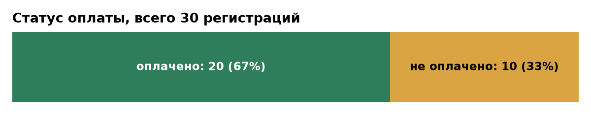
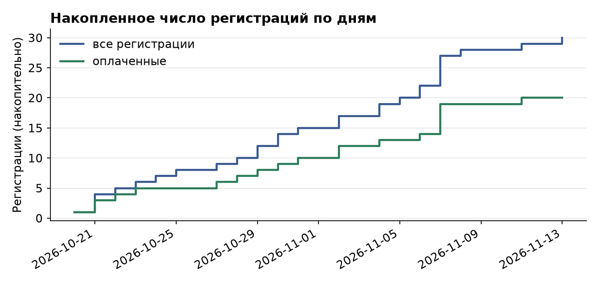
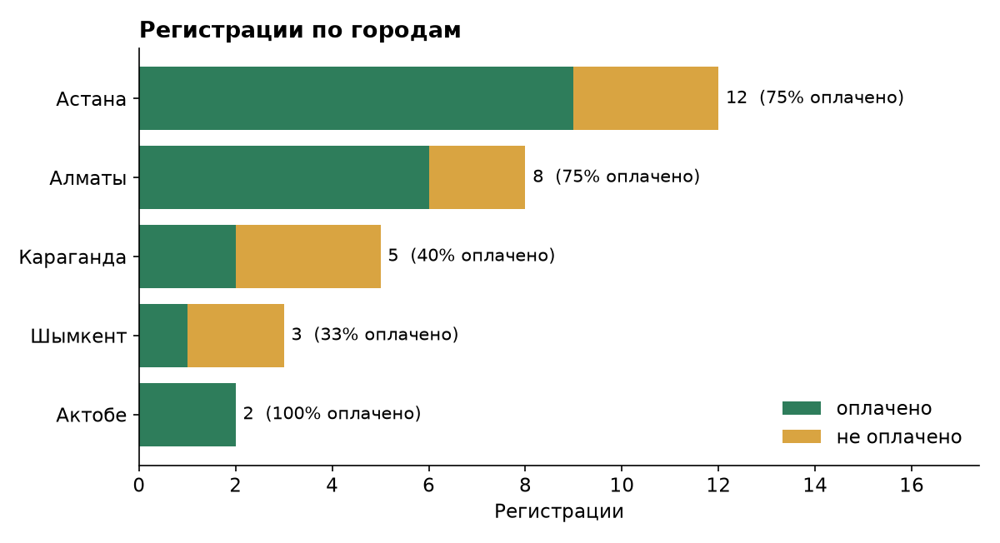
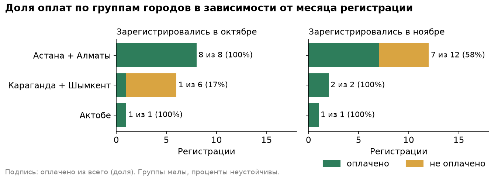
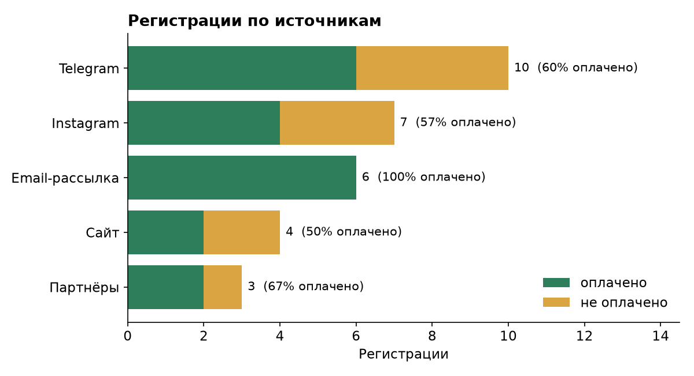
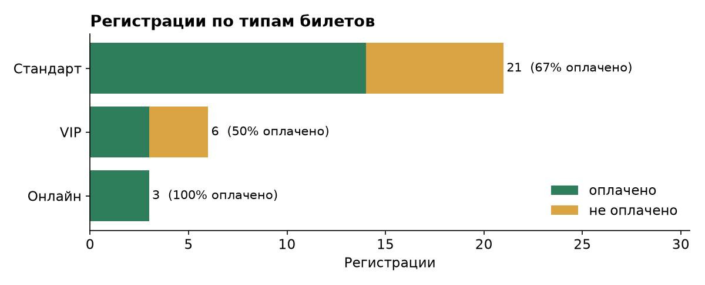
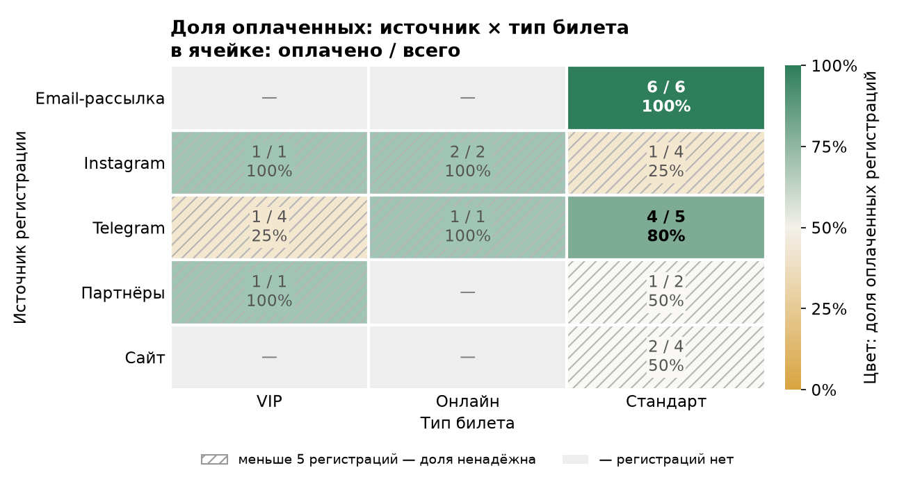

# Анализ регистраций на мероприятие

**Источник данных:** `registrations.csv`, 30 регистраций с 20 октября по 13 ноября 2026 года.
**Как получены цифры:** все показатели и графики считает скрипт [`analysis.py`](analysis.py) (`py analysis.py`). Исходный CSV только читается и не меняется.
**Отчёт обновлён после критического аудита:** что изменилось, описано в разделе 11.

> **Важно про объём данных.** В файле всего 30 строк. Во многих группах по 2–6 человек, поэтому одна регистрация меняет процент оплат на 15–50 пунктов. Различия в отчёте показывают, куда стоит посмотреть, но статистически доказанными закономерностями их считать нельзя.

---

## 1. Краткое резюме

- **30 регистраций, из них 20 оплачены (67%)**, 10 не оплачены (33%).
- **Астана и Алматы дают 2/3 регистраций** (20 из 30) и **75% оплаченных** (15 из 20).
- **Караганда и Шымкент в целом платят заметно хуже:** оплачено 3 из 8 регистраций (38%). **Но этот разрыв наблюдается только среди октябрьских регистраций.** В октябре Астана + Алматы оплатили 8 из 8, а Караганда + Шымкент 1 из 6. В ноябре картина обратная: 7 из 12 против 2 из 2. Разрыв может быть связан со временем регистрации, а не только с городом (раздел 3).
- **Telegram — самый массовый источник** (10 регистраций), но оплатили только 60%.
- **Email-рассылка — самый надёжный источник:** оплачены все 6 регистраций из 6.
- **Чаще всего берут билет «Стандарт»** (70% регистраций). VIP оплачен только в половине случаев.
- **Главная зона риска — неоплаченные VIP из Telegram:** 3 из 4 таких регистраций не оплачены.
- **Половина неоплаченных регистраций «старые»:** 5 из 10 сделаны до 30 октября включительно и не оплачены уже 2+ недели.

---

## 2. Общая статистика

| Показатель | Значение |
|---|---|
| Всего регистраций | **30** |
| Оплачено | **20** (66,7%) |
| Не оплачено | **10** (33,3%) |
| Период регистраций | 20.10.2026 — 13.11.2026 (25 дней) |
| Дней, в которые были регистрации | 19 |
| Городов | 5 |
| Источников | 5 |
| Типов билетов | 3 |

### Динамика по неделям

| Неделя | Регистраций | Оплачено | Доля оплат |
|---|---|---|---|
| 19–25 октября | 8 | 5 | 63% |
| 26 октября — 1 ноября | 7 | 5 | 71% |
| 2–8 ноября | **13** | 9 | 69% |
| 9–15 ноября (данные до 13.11) | 2 | 1 | 50% |

- Пик пришёлся на неделю 2–8 ноября: 13 регистраций, почти половина всех.
- **Самый активный день — 7 ноября:** 5 регистраций, все оплачены. Источники у них разные (Сайт, Instagram, Email, 2 × Telegram), поэтому по данным нельзя сказать, что пик дала одна кампания.
- После 8 ноября регистраций почти нет: только 2 за 11 и 13 ноября.
- Регистрации до и после 1 ноября распределились поровну (по 15), доля оплат в обеих половинах одинаковая (67%).

---

## 3. Анализ городов

| Город | Регистраций | Доля регистраций | Оплачено | Не оплачено | Доля оплат | Доля от всех оплат |
|---|---|---|---|---|---|---|
| Астана | **12** | 40,0% | 9 | 3 | 75% | 45% |
| Алматы | 8 | 26,7% | 6 | 2 | 75% | 30% |
| Караганда | 5 | 16,7% | 2 | 3 | **40%** | 10% |
| Шымкент | 3 | 10,0% | 1 | 2 | **33%** | 5% |
| Актобе | 2 | 6,7% | 2 | 0 | 100% | 10% |

**Выводы:**
- Астана — главный город: 40% регистраций и 45% оплат.
- Если сгруппировать города, разница в оплатах большая:

| Группа | Регистраций | Оплачено | Доля оплат |
|---|---|---|---|
| Астана + Алматы | 20 | 15 | **75%** |
| Караганда + Шымкент | 8 | 3 | **38%** |
| Актобе | 2 | 2 | 100% |

- Неоплаченные в Караганде и Шымкенте не новые: все 5 зарегистрировались с 21 по 30 октября.
- Актобе: 100% оплат, но это всего 2 человека.

### Города × месяц регистрации

Общие цифры по городам складываются из двух разных месяцев, и в каждом месяце картина своя.

**По группам городов:**

| Группа | Октябрь: оплачено / всего | Доля оплат | Ноябрь: оплачено / всего | Доля оплат | Всего за период |
|---|---|---|---|---|---|
| Астана + Алматы | 8 / 8 | **100%** | 7 / 12 | **58%** | 15 / 20 (75%) |
| Караганда + Шымкент | 1 / 6 | **17%** | 2 / 2 | **100%** | 3 / 8 (38%) |
| Актобе | 1 / 1 | 100% | 1 / 1 | 100% | 2 / 2 (100%) |
| **Все города** | **10 / 15** | **67%** | **10 / 15** | **67%** | 20 / 30 (67%) |

**По отдельным городам:**

| Город | Октябрь: оплачено / всего | Ноябрь: оплачено / всего |
|---|---|---|
| Астана | 4 / 4 | 5 / 8 |
| Алматы | 4 / 4 | 2 / 4 |
| Караганда | 0 / 3 | 2 / 2 |
| Шымкент | 1 / 3 | нет регистраций |
| Актобе | 1 / 1 | 1 / 1 |

Октябрь — регистрации с 20 по 31 октября, ноябрь — с 1 по 13 ноября (данных за 1 ноября нет, поэтому граница та же, что и в разделе 2).

**Что видно:**
- **В октябре и ноябре наблюдаются разные картины оплаты.** Среди октябрьских регистраций Астана + Алматы оплатили всё (8 из 8), а Караганда + Шымкент только 1 из 6. Среди ноябрьских всё наоборот: в Астане + Алматы оплачено 7 из 12, в Караганде оба ноябрьских участника оплатили (2 из 2).
- **Общий разрыв «75% против 38%» может быть связан со временем регистрации, а не только с городом.** Почти весь разрыв даёт одна группа: 5 неоплаченных октябрьских регистраций из Караганды и Шымкента. В ноябре наблюдается различие в другую сторону.
- **В Караганде все три октябрьские регистрации не оплачены, обе ноябрьские оплачены.** Такая резкая смена может быть связана с чем-то, что происходило именно в октябре (конкретная кампания или партнёр, способ оплаты, не обновлённый статус `paid`). По этим данным причину установить нельзя, это требует дополнительной проверки.
- **Ноябрьские неоплаты в Астане и Алматы (5 из 12) частично могут объясняться тем, что люди ещё не успели оплатить:** даты оплаты в файле нет, а последние регистрации сделаны 8 и 13 ноября.
- **Группы маленькие** (от 1 до 12 регистраций в ячейке), поэтому проценты неустойчивы: одна регистрация меняет долю на 8–100 пунктов. Различия показывают, где искать, но не доказывают закономерность.
- **Что стоит проверить:** что происходило с регистрациями в Караганде и Шымкенте в октябре (источник, кампания, способ оплаты) и актуален ли у этих 5 человек статус `paid`.

---

## 4. Анализ источников регистрации

По договорённости источник оценивается по двум показателям сразу: **сколько людей он приводит** и **какая доля из них оплачивает**.

| Источник | Регистраций | Доля регистраций | Оплачено | Доля оплат | Доля от всех оплат |
|---|---|---|---|---|---|
| Telegram | **10** | 33,3% | 6 | 60% | 30% |
| Instagram | 7 | 23,3% | 4 | 57% | 20% |
| Email-рассылка | 6 | 20,0% | 6 | **100%** | 30% |
| Сайт | 4 | 13,3% | 2 | 50% | 10% |
| Партнёры | 3 | 10,0% | 2 | 67% | 10% |

**Сравнение по двум показателям:**

| Источник | Объём | Качество (оплаты) | Итог |
|---|---|---|---|
| Email-рассылка | средний | лучший (6 из 6) | **лучший по сочетанию** |
| Telegram | наибольший | ниже среднего (60%) | основной канал привлечения, но с «хвостом» неоплат |
| Instagram | второй | ниже среднего (57%) | похож на Telegram |
| Партнёры | малый | на уровне среднего (67%) | мало данных для вывода |
| Сайт | малый | худший (50%) | мало данных, 2 из 4 не оплачены |

- **Email и Telegram принесли одинаковое число оплаченных (по 6)**, но Telegram потребовал для этого 10 регистраций, а Email только 6.
- Соцсети (Telegram + Instagram) дали 17 регистраций и 7 из 10 неоплаченных.

---

## 5. Анализ типов билетов

| Тип билета | Регистраций | Доля регистраций | Оплачено | Доля оплат |
|---|---|---|---|---|
| Стандарт | **21** | 70,0% | 14 | 67% |
| VIP | 6 | 20,0% | 3 | **50%** |
| Онлайн | 3 | 10,0% | 3 | 100% |

- «Стандарт» — основной билет: 7 из 10 регистраций.
- VIP оплачивают хуже всего: 3 из 6. При этом VIP, скорее всего, самый дорогой билет, но цен в файле нет, поэтому оценить потери в деньгах нельзя.
- Онлайн-билеты оплачены все (3 из 3), но их мало.

---

## 6. Анализ оплат

**Все 10 неоплаченных регистраций:**

| Имя | Город | Дата регистрации | Источник | Билет |
|---|---|---|---|---|
| Ерасыл | Караганда | 21.10 | Партнёры | Стандарт |
| Олжас | Караганда | 24.10 | Instagram | Стандарт |
| Елена | Караганда | 25.10 | Telegram | Стандарт |
| Санжар | Шымкент | 29.10 | Instagram | Стандарт |
| Гульнара | Шымкент | 30.10 | Telegram | VIP |
| Айдана | Астана | 04.11 | Instagram | Стандарт |
| Камила | Алматы | 05.11 | Сайт | Стандарт |
| Марат | Астана | 06.11 | Сайт | Стандарт |
| Алина | Астана | 08.11 | Telegram | VIP |
| Бекзат | Алматы | 13.11 | Telegram | VIP |

**Что видно:**
- Неоплаченные разделились на две группы:
  - **«давние» (21–30 октября), 5 человек:** все из Караганды и Шымкента, на момент последней даты в файле прошло 2–3 недели;
  - **«свежие» (4–13 ноября), 5 человек:** все из Астаны и Алматы, могут ещё оплатить.
- 3 из 10 неоплаченных — VIP, и все трое пришли из Telegram.
- Ни одной неоплаченной регистрации из Email-рассылки.

---

## 7. Взаимосвязи между показателями

### Источник × тип билета

**Как читать график:** цвет ячейки показывает **долю оплаченных регистраций** (зелёный — ближе к 100%, светлый — около 50%, жёлто-оранжевый — ближе к 0%). В ячейке написано «оплачено / всего» и доля. Ячейки, где меньше 5 регистраций, сделаны бледными и заштрихованными: доля в них ненадёжна, одна регистрация меняет её на 25–100 пунктов. Таких ячеек большинство, полноцветных только две (Email-рассылка × Стандарт и Telegram × Стандарт). «—» означает, что регистраций нет.

| Источник | VIP (оплачено/всего) | Онлайн | Стандарт |
|---|---|---|---|
| Email-рассылка | — | — | 6 / 6 |
| Instagram | 1 / 1 | 2 / 2 | **1 / 4** |
| Telegram | **1 / 4** | 1 / 1 | 4 / 5 |
| Партнёры | 1 / 1 | — | 1 / 2 |
| Сайт | — | — | 2 / 4 |

- **Telegram — главный источник VIP-регистраций** (4 из 6), но из них оплачен только 1. VIP из других источников оплачены оба (2 из 2).
- **Instagram:** «Онлайн» и VIP оплачены (3 из 3), а «Стандарт» только 1 из 4.
- Email-рассылка и Сайт приводили только на «Стандарт».

### Город × источник (всего регистраций)

| Город | Email | Instagram | Telegram | Партнёры | Сайт |
|---|---|---|---|---|---|
| Астана | 3 | 4 | 3 | 0 | 2 |
| Алматы | 1 | 0 | 3 | 2 | 2 |
| Караганда | 0 | 2 | 2 | 1 | 0 |
| Шымкент | 0 | 1 | 2 | 0 | 0 |
| Актобе | 2 | 0 | 0 | 0 | 0 |

- **В Караганде и Шымкенте нет ни одной регистрации из Email и с Сайта**, только соцсети и партнёры. Эти же города хуже всех платят. Данных слишком мало, чтобы понять, в чём причина: в городе или в источнике.
- Актобе пришёл целиком через Email-рассылку.
- В Instagram нет ни одной регистрации из Алматы, Партнёры дают только Алматы и Караганду.

### Город × тип билета

| Город | VIP | Онлайн | Стандарт |
|---|---|---|---|
| Астана | 3 | 2 | 7 |
| Алматы | 2 | 0 | 6 |
| Караганда | 0 | 0 | 5 |
| Шымкент | 1 | 1 | 1 |
| Актобе | 0 | 0 | 2 |

- VIP берут в основном в Астане и Алматы (5 из 6).
- Онлайн-билеты взяли жители Астаны и Шымкента. Билет «Онлайн» не требует присутствия, поэтому город у этих людей, видимо, означает место проживания, а не площадку.

---

## 8. Найденные интересные закономерности

1. **Email-рассылка — единственный источник без неоплат** (6 из 6). Это люди, которые уже знакомы с организаторами, и они платят лучше всего.
2. **Telegram приводит много людей, в том числе на VIP, но VIP оттуда почти не оплачивают** (1 из 4).
3. **Есть региональный разрыв, но он может быть связан со временем регистрации:** в целом Астана и Алматы платят в 75% случаев, Караганда и Шымкент в 38%. Однако разрыв наблюдается только среди октябрьских регистраций (100% против 17%), а в ноябре картина обратная (58% против 100%). Неоплаты Караганды и Шымкента «зависли» с октября. Чем это вызвано — городом, октябрьской кампанией или чем-то ещё, — требует дополнительной проверки.
4. **Регистрации сосредоточены в неделе 2–8 ноября**, с пиком 7 ноября (5 регистраций, все оплачены). После 8 ноября поток почти остановился.
5. **В целом доля оплат по месяцам одинаковая, но внутри групп городов она разная:** в обеих половинах периода оплачено по 67%, однако это совпадение двух противоположных изменений (в Астане + Алматы доля оплат в ноябре ниже, в Караганде + Шымкенте выше, раздел 3). Поэтому из равенства 67% нельзя делать вывод, что время регистрации не связано с оплатой. Поздние неоплаты пока могут объясняться тем, что люди ещё не успели заплатить.

---

## 9. Возможные проблемы качества данных

**Что проверено и в порядке:**

| Проверка | Результат |
|---|---|
| Пустые значения | нет ни в одной колонке |
| Лишние пробелы, разный регистр, разное написание («москва»/«Москва») | не найдено, нормализация не понадобилась |
| Полные дубликаты строк | нет |
| Повторяющиеся имена | нет |
| Формат дат | все 30 дат корректны (ГГГГ-ММ-ДД) |
| Значения `paid` | только «да» и «нет» |
| Кодировка | UTF-8 без BOM, файл читается корректно |

**Ограничения, которые влияют на выводы:**

1. **Маленькая выборка (30 строк).** Во всех группах меньше 13 человек, поэтому проценты сильно «прыгают». Например, у Актобе 100% оплат при 2 регистрациях.
2. **Нет уникального идентификатора** (email, телефон, ID). Записаны только имена, без фамилий, поэтому повторную регистрацию одного человека нельзя ни найти, ни исключить.
3. **Нет цен билетов и сумм оплат.** Нельзя посчитать выручку или потери от неоплаченных VIP.
4. **Нет даты оплаты и даты мероприятия.** Непонятно, просрочены ли неоплаты, и сколько времени осталось до события.
5. **Файл — снимок на некоторую дату.** Последняя регистрация 13 ноября. Неизвестно, полный ли это список и меняется ли статус `paid` со временем.
6. **Поле `city` у онлайн-участников**, скорее всего, означает город проживания, а не место участия. Из данных это не подтвердить.
7. **Нет причины неоплаты** (отказ, ожидание счёта, бесплатный пропуск и т.д.).

---

## 10. Практические выводы для организаторов

1. **Связаться с 10 неоплаченными, начиная с 5 «давних»** (Караганда и Шымкент, регистрации 21–30 октября). Они ждут дольше всех, и их легче всего потерять. Полный список в разделе 6.
2. **Отдельно напомнить 3 неоплаченным VIP из Telegram** (Гульнара, Алина, Бекзат). Если VIP дороже, это самые ценные неоплаты.
3. **Активнее использовать Email-рассылку:** в этих данных у неё 100% оплат. Например, рассылка-напоминание по городам, где её пока не было (Караганда, Шымкент).
4. **Проверить путь от регистрации до оплаты в Telegram и Instagram:** соцсети дали 17 из 30 регистраций и 7 из 10 неоплат.
5. **Понять, что сработало 7 ноября,** и выяснить, почему после 8 ноября поток почти остановился. В данных ответа нет, нужно сверить с графиком публикаций и рассылок.
6. **Улучшить сбор данных к следующему разу:** добавить email/телефон (для поиска дублей и напоминаний), цену билета, дату оплаты и UTM-метку кампании, а также договориться, что значит город у онлайн-участников.
7. **Перепроверить выводы на большей выборке:** все различия выше основаны на 30 регистрациях и могут оказаться случайными.

---

## 11. Что исправлено после критического аудита

После первой версии отчёта был проведён критический аудит. В этой версии исправлены две из найденных проблем. Остальные замечания аудита пока не исправлены.

**1. Добавлен анализ «город × месяц регистрации» (замечание B1 аудита).**
- *Что было не так:* города сравнивались только в целом за весь период. Из-за этого не было видно, что разрыв между Астаной + Алматы и Карагандой + Шымкентом наблюдается только среди октябрьских регистраций, а в ноябре картина обратная.
- *Что сделано:* в раздел 3 добавлен подраздел «Города × месяц регистрации» с таблицами по группам городов и по отдельным городам, а также график [`charts/city_month.png`](charts/city_month.png). Выводы в резюме (раздел 1) и в пунктах 3 и 5 раздела 8 уточнены: разрыв между городами может быть связан со временем регистрации, а равенство 67% в октябре и ноябре не означает, что время не связано с оплатой.
- Расчёт добавлен в `analysis.py`: скрипт печатает таблицы «город × месяц» и «группа городов × месяц» и строит новый график.

**2. Переделана тепловая карта «Источник × тип билета» (замечание E1 аудита).**
- *Что было не так:* цвет ячеек показывал число регистраций, а подписи — оплату. Ячейка «1 из 4» (VIP из Telegram) была тёмной и выглядела как успех, хотя это одна из худших долей оплат.
- *Что сделано:* в [`charts/source_ticket.png`](charts/source_ticket.png) цвет теперь показывает долю оплаченных регистраций (шкала 0–100% подписана справа). В ячейке указано «оплачено / всего» и доля. Ячейки, где меньше 5 регистраций, бледные и заштрихованы, чтобы маленькие группы не выглядели надёжными. Подписаны оси и пояснение под графиком.

Все новые цифры пересчитаны скриптом из `registrations.csv` и вручную сверены с исходными строками. Сам `registrations.csv` не изменялся.
